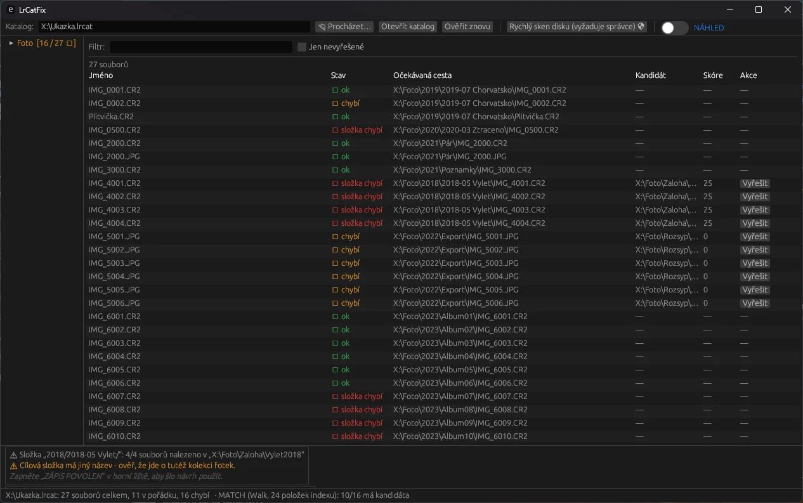

# LrCatFix

> 🇬🇧 [English version](README.md)

Desktopový nástroj pro Windows, který v katalogu **Lightroom Classic** (`.lrcat`) najde fotky s neplatnou cestou, dohledá je na disku a — **až po tvém schválení každé změny** — opraví cesty v databázi.

Napsáno v Rustu, GUI přes `egui`. Použitelné i headless z příkazové řádky.



*Screenshot z fiktivního testovacího katalogu (stejné scénáře jako `tests/fixtures/make.rs`).*

---

## Jaký problém řeší

Lightroom Classic si v katalogu drží absolutní cesty k souborům. Jakmile fotky přesuneš mimo Lightroom — přeorganizuješ složky, změní se písmeno externího disku, obnovíš data ze zálohy — LrC ukáže `!` u každé dotčené fotky. Vestavěná funkce *Find Missing Photos* umí opravovat jen složku po složce a ručně.

LrCatFix hledání automatizuje a hlavně rozpoznává **vzory** místo toho, aby 30 000 rozbitých fotek řešil jako 30 000 nesouvisejících problémů:

| Vzor | Detekce | Nabízené řešení |
|---|---|---|
| **Změna písmene disku** (`E:` → `F:`) | Sonda svazků při startu, < 1 s, bez skenování disku | Jeden `UPDATE` na kořenové složce |
| **Přesunutá složka** | ≥ 80 % souborů složky nalezeno pohromadě jinde | Jeden `UPDATE` na složce — nebo přesun souborů zpět |
| **Rozsypaná složka** | Soubory rozházené v ≥ 5 různých složkách | Konsolidace zpět do zdrojové složky |
| **Rozházené album** | Kolekce ve ≥ 10 složkách, ≥ 30 % chybí | Pouze detekce — viz [Omezení](#omezení) |

Přejmenovaná složka se detekuje stejně spolehlivě jako přesunutá: detekce vychází z toho, **kde se soubory skutečně našly**, ne z podobnosti jmen složek.

---

## Bezpečnostní model

V katalogu jsou roky nenahraditelné práce. Řídící pravidlo celého kódu zní:

> **Poškozený katalog je horší než nefunkční nástroj.**

Konkrétně, a vynuceno v kódu:

- **Výchozí režim je náhled.** Zápis vyžaduje explicitní přepnutí a potvrzovací dialog, který přesně říká, co se stane (kolik řádků DB, kolik přesunů, kolik GB).
- **Žádný zápis bez ověřené zálohy.** Záloha musí projít `PRAGMA integrity_check` a kontrolou velikosti dřív, než se vůbec otevře zapisovací spojení.
- **Odmítne zapisovat, když běží Lightroom.** `.lrcat.lock` / `-journal` / `-wal` se kontrolují znovu těsně před zápisem, ne jen při startu.
- **Nikdy nesahá na** `journal_mode`, `page_size`, `encoding`, `user_version`. Žádný `VACUUM`, žádný `writable_schema`.
- **Nikdy nemaže soubor.** Jediná výjimka je smazání zdroje po bajtově ověřené kopii přes svazky — to je definice přesunu, ne úklid.
- **Dvoufázový commit s kompenzací.** Nejdřív přesuny na disku, SQL se generuje až z těch, které prokazatelně proběhly. Když selže DB transakce, provedené přesuny se vrátí zpět.
- **Všechno je v journalu dřív, než se to provede** (`journal.jsonl`, s `fsync`), aby šlo undo přehrát pozpátku.
- **Schema guard.** Tabulky i sloupce se ověřují před jakýmkoli dotazem. Nikdy žádný `SELECT *`.
- **Nedostupné ≠ chybějící.** Odpojené NAS se hlásí odlišně od skutečně smazané složky a soubory na něm se k opravě **nikdy** nenabídnou. Bez toho rozlišení by odpojený disk vypadal jako ztracené fotky a nástroj by nabídl přepointovat katalog na zálohu.
- **Žádné paniky v produkčním kódu.** Mimo testy žádné `.unwrap()`/`.expect()`; GUI vrstva nesmí panikařit nikdy.

---

## Instalace

Potřebuješ Rust toolchain. Na Windows funguje MSVC i GNU (MinGW-w64) target.

```bash
git clone <repo>
cd lrrepair
cargo build --release
```

Výsledek je jediný samostatný `lrcatfix.exe` — bez runtime, bez instalátoru.

---

## Použití

### GUI

```bash
lrcatfix                                  # spustí prázdné, katalog otevřeš v UI
lrcatfix --catalog "D:\Foto\Katalog.lrcat"
```

Rozvržení ve stylu Total Commanderu: vlevo strom složek, vpravo tabulka souborů (virtualizovaná — 30 000 řádků scrolluje plynule), dole karty s návrhy, ve status baru indikace režimu. **NÁHLED** je modrý, **ZÁPIS POVOLEN** červený — nikdy nemáš být na pochybách, jestli právě měníš data.

### CLI (read-only report)

```bash
lrcatfix --catalog <cesta.lrcat> --headless
lrcatfix --catalog <cesta.lrcat> --headless --report out.json
```

Vypíše:

* počty (v pořádku / chybí / chybí celá složka / na nedostupném disku);
* statistiku MATCH plus **rozložení nejlepšího skóre** a diagnostiku, proč důvěryhodné shody vznikly nebo nevznikly (např. zda je k dispozici velikost souboru z `importHash`, když `md5` chybí);
* **všechny čtyři vzory CLUSTER** — přemapování kořene (D), přesunutá složka (A), rozsypaná složka (B), rozházené album (C). CLI i GUI volají tentýž `cluster::detect_all`, takže se nemůžou rozejít.

`--report` navíc zapíše kompletní kandidáty po souborech jako JSON.

### CLI (zápis)

```bash
# Vypíše souhrn a skončí BEZ zápisu:
lrcatfix --catalog <cesta.lrcat> --headless --apply-root-remap 3

# Skutečně zapíše (záloha se vytvoří automaticky předtím):
lrcatfix --catalog <cesta.lrcat> --headless --apply-root-remap 3 --confirm
```

### Další přepínače

| Přepínač | Význam |
|---|---|
| `--resume <session.json>` | Interní — použije se, když se GUI restartuje s právy správce kvůli rychlému MFT skenu |

---

## Jak to funguje — pipeline

```
[0] OPEN      detekce zámků, schema guard
[1] EXTRACT   SQL join → očekávaná absolutní cesta pro každý AgLibraryFile řádek
[2] VERIFY    dávkové ověření existence (jeden read_dir na složku, paralelně)
[3] INDEX     Everything IPC → MFT scan → paralelní walk (první, co funguje)
[4] MATCH     kandidáti podle jména + skórování
[5] CLUSTER   detekce vzorů, vyhodnocení v pořadí D → A → B → C
[6] REVIEW    schválíš nebo zamítneš každý návrh
[7] APPLY     záloha → journal → dvoufázový commit
[8] UNDO      přehrání journalu pozpátku
```

Fáze 1–5 jsou striktně read-only a opakovatelné.

### Skórování (fáze MATCH)

Kandidáti sdílejí jméno souboru; skóre rozhoduje, který je ten správný:

| Signál | Body |
|---|---|
| Sourozenci — další soubory ze stejné zdrojové složky nalezené ve stejném cíli | +25 |
| `externalModTime` odpovídá (± 2 s) | +25 |
| Relativní podcesta souhlasí přesně | +15 |
| Jméno cílové složky je podobné (normalizovaná Levenshteinova vzdálenost ≥ 0,7) | +8 |
| Kandidát je ve složce, kterou katalog už zná | +5 |
| **Velikost souboru odpovídá katalogu** | **+30** |
| MD5 souhlasí se sloupcem `md5` v katalogu | +100 (jistota) |
| Kandidát je cloud placeholder | −5 |
| Kandidát je v koši / `Temp` | −50 |
| Kandidát je v zálohách LrC nebo v `*.lrdata` | −100 |

Auto-resolve vyžaduje skóre ≥ 70 **a zároveň** náskok ≥ 15 bodů před druhým — a i pak jen navrhuje; schvaluje vždy člověk.

**Odkud se bere velikost souboru.** Katalog nemá vyhrazený sloupec s velikostí, ale `AgLibraryFile.importHash` ji v sobě nese. Ověřeno na LrC 13.3 (vzorek 5 000 řádků):

```
189345639 : S7301073.JPG : 3299111
captureTime  originalFilename  velikost v bajtech
(Apple epocha)
```

Pole 1 se rovná `originalFilename` u 5000/5000 řádků, pole 0 čtené jako Apple epocha padne do jednoho roku od `captureTime` u 5000/5000 a pole 2 se rovná skutečné velikosti na disku u 2953/2958 existujících souborů (99,83 %). Těch 5 odchylek byly `.dng`, `.png` a `.tif` — tedy formáty, do kterých LrC zapisuje metadata zpět do souboru — takže **neshoda velikosti není nikdy penalizace, jen absence bonusu.** Na katalozích, jejichž schéma `importHash` nemá, se signál sám vypne.

Má to význam proto, že `md5` je v reálných katalozích prázdné (viz *Omezení*), což by jinak srazilo dosažitelné maximum na 63 bodů — pod práh.

Časový signál se **kalibruje empiricky za běhu**: nástroj porovná skutečný `mtime` ~200 existujících souborů s hodnotou v katalogu a z toho určí epochu a jednotku. Když je korelace pod 95 %, signál se úplně vypne, místo aby se hádalo.

---

## Struktura repozitáře

```
src/
  main.rs               parsování CLI argumentů, vstupní bod, headless report
  lib.rs                kořen knihovny (vše kromě CLI/GUI obalu)
  config.rs             výchozí hodnoty podle PROJECT.md §14
  session.rs            minimální session pro restart s elevací (--resume)

  catalog/              vše kolem .lrcat SQLite souboru
    open.rs             detekce zámků, read-only / read-write spojení
    schema.rs           schema guard — ověří existenci tabulek a sloupců
    extract.rs          hlavní EXTRACT dotaz, členství v kolekcích
    apply.rs            dvoufázový commit, stavitelé plánů, VerifiedPath
    backup.rs           ověřená záloha vč. kontroly volného místa
    ids.rs              generování id_local / id_global pro nové řádky

  fsops/                operace se souborovým systémem
    paths.rs            verbatim \\?\ konverze, NFC klíče pro porovnání
    verify.rs           dávkové ověření existence, FileStatus
    attrs.rs            detekce cloud placeholderů, velikost/mtime
    moves.rs            přesuny s retry, seskupení sidecarů
    hash.rs             MD5 (kompatibilita s katalogem)
    exif_thumbnail.rs   extrakce vloženého JPEG náhledu
    shell.rs            „Otevřít v Průzkumníku", restart s elevací
    volumes.rs          enumerace disků, volné místo, detekce sítě

  index/                index disku (vrstva ve stylu „Everything")
    mod.rs              NameIndex, výběr backendu, vylučovací vzory
    everything.rs       backend A — subprocess es.exe
    mft.rs              backend B — NTFS MFT scan (jediný unsafe kód)
    walk.rs             backend C — paralelní walk (jwalk)
    cache.rs            cache indexu na disku s TTL

  matching/
    score.rs            skórování kandidátů
    calibrate.rs        runtime kalibrace časové epochy

  cluster/              detekce vzorů
    root_remap.rs       vzor D — změna písmene disku / kořene
    folder_moved.rs     vzor A — přestěhovaná složka
    scattered.rs        vzor B — rozsypaná složka
    album_scattered.rs  vzor C — rozházená kolekce (jen detekce)

  journal/
    write.rs            append-only JSONL journal, fsync před akcí
    undo.rs             zpětné přehrání

  app/                  egui GUI — jen UI, žádné SQL ani přímé I/O
    state.rs            AppState, vlákna na pozadí, orchestrace zápisu
    panel_tree.rs       levý panel — strom složek s odznaky
    panel_files.rs      pravý panel — virtualizovaná tabulka souborů
    panel_plans.rs      dolní panel — karty s návrhy
    dialogs/duplicates.rs   dialog výběru z duplikátů (§6.2)

tests/
  fixtures/make.rs      generátor realistického katalogu + stromu souborů
  m0_pipeline.rs        read-only pipeline
  full_pipeline.rs      plná pipeline vč. skutečných zápisů a undo
  compensation.rs       povinný test kompenzační fáze
```

**Architektonická hranice:** `app/` neobsahuje žádné SQL ani přímé I/O — volá jen do `catalog/`, `fsops/`, `index/`, `cluster/`. Díky tomu jde celá logika testovat bez spuštění GUI.

---

## Klíčová API

### Katalog

| Funkce | K čemu je |
|---|---|
| `catalog::open::open_read_only(path)` | Otevře s `SQLITE_OPEN_READ_ONLY`, spustí schema guard |
| `catalog::open::open_read_write(path)` | Totéž, ale odmítne, když jsou přítomné zámkové soubory |
| `catalog::open::detect_lock(path)` | Zkontroluje `.lock` / `-journal` / `-wal` |
| `catalog::extract::extract(conn)` | Hlavní dotaz → `Vec<CatalogFile>` s očekávanými cestami |
| `catalog::backup::create_backup(path)` | Ověřená záloha (integrity check + velikost) |
| `catalog::apply::apply(...)` | Jediný vstupní bod pro každý zápis |
| `catalog::apply::VerifiedPath::check(path)` | Pre-flight; jediný způsob, jak doložit existenci cíle |

`VerifiedPath` stojí za zmínku: stavitelé plánů přijímají **výhradně** tenhle typ, takže kontrolu existence nejde zapomenout — hlídá to kompilátor. Neřeší to TOCTOU; zkracuje to okno z „jak dlouho uživatel odklikával dialogy" na milisekundy.

### Souborový systém

| Funkce | K čemu je |
|---|---|
| `fsops::paths::to_verbatim(path)` | **Jediné** místo, které skládá `\\?\` cesty (pracuje nad WTF-16, takže nepárové surrogáty přežijí) |
| `fsops::paths::match_key(name)` | Normalizovaný klíč pro porovnání — lowercase, pak NFC. **Nikdy** nepoužívat k I/O |
| `fsops::verify::verify(files, threads)` | Dávkové ověření existence |
| `fsops::moves::move_file(src, dst)` | Přesun s retry; přes svazky = kopie → ověření → smazání |
| `fsops::moves::find_sidecars(...)` | Najde `.xmp`/`.wav`/… patřící k souboru |

### Index, matching, clustering

| Funkce | K čemu je |
|---|---|
| `index::build_index(...)` | Zkouší backendy A → B → C, obsluhuje cache |
| `matching::run(...)` | INDEX + kalibrace + skórování v jednom kroku |
| `cluster::root_remap::probe_all(...)` | Sonda svazků (před jakýmkoli skenem) |
| `cluster::folder_moved::detect(...)` | Vzor A |
| `cluster::scattered::detect(...)` | Vzor B |
| `cluster::album_scattered::detect(...)` | Vzor C |

---

## Konfigurace

Výchozí hodnoty (z `PROJECT.md` §14):

| Klíč | Výchozí | Význam |
|---|---|---|
| `scan.threads_local` | 16 | I/O vlákna pro lokální svazky |
| `scan.threads_network` | 4 | I/O vlákna pro síťové svazky |
| `match.auto_threshold` | 70 | Skóre potřebné pro důvěryhodnou shodu |
| `match.tie_margin` | 15 | Požadovaný náskok před druhým kandidátem |
| `match.folder_name_similarity` | true | Zapíná bonus za podobnost jména složky |

> **Pozor:** načítání `config.toml` ze souboru **zatím není implementované** — nástroj běží na těchhle vestavěných výchozích hodnotách.

---

## Vývoj

```bash
cargo build                  # debug
cargo build --release        # výkonové cíle měř výhradně tady
cargo test                   # 249 testů
cargo clippy --all-targets -- -D warnings
cargo fmt --check
cargo test --test compensation   # povinný test kompenzace
```

Před každým commitem musí projít `cargo fmt --check`, `cargo clippy -- -D warnings` i `cargo test`.

Testy nikdy neběží nad produkčním katalogem. `tests/fixtures/make.rs` generuje pro každý test čerstvý syntetický katalog i odpovídající strom souborů a pokrývá: NFC/NFD diakritiku, cesty > 260 znaků, skupiny RAW + `.xmp` + `.wav`, RAW + JPEG jako dva nezávislé řádky, virtuální kopii, prázdnou složku, přesunutou složku, rozsypanou složku a rozházenou kolekci.

---

## Omezení

Vědomá rozhodnutí o rozsahu, ne opomenutí:

- **Jen Lightroom Classic.** Lightroom CC (cloudový) není podporovaný.
- **Jen cesty.** Vývojová nastavení, historie úprav, klíčová slova, kolekce ani hodnocení se nikdy nemění. Náhledy (`Previews.lrdata`) se nikdy nedotýkáme.
- **Žádný plně automatický režim.** Auto-match navrhuje, člověk schvaluje.
- **Sloučení alba (vzor C) je jen detekce.** Spec sama označuje fyzické sloučení za nejdestruktivnější operaci v nástroji; potřebuje vlastní dialog s dvojím potvrzením, který zatím neexistuje.
- **Kolize jmen při konsolidaci se odmítnou a nahlásí**, nikdy se tiše nepřeskočí ani nepřepíšou. Strategie „přejmenovat na `_1`" a „vybrat ručně" nejsou implementované.
- **Založení úplně nového kořene je mimo rozsah** — cíl opravy musí spadat pod kořen, který katalog už zná.
- **Identifikace podle sériového čísla svazku** (`PROJECT.md` §7.4.2) není implementovaná: nešlo ověřit, jestli LrC identifikátor vůbec ukládá, a hádání pravidla projektu zakazují. Sonda svazků dosahuje prakticky téhož výsledku.
- **`config.toml` se zatím ze souboru nečte.**

### Co není ověřené

Říkám to na rovinu, protože než na tohle pustíš reálný katalog, je to podstatné:

- **Zápis nikdy neproběhl proti skutečnému katalogu vytvořenému Lightroomem.** Všechny testy běží nad syntetickými fixtures. Čtení se ale ověřilo nad kopií reálného katalogu LrC 13.3 (26 807 souborů), což vyřešilo čtyři dosud neověřené otázky:
  - `externalModTime` je `REAL` v **Apple epoše** (2001-01-01); runtime kalibrace to potvrdila se 100% shodou.
  - **`md5` je `NULL` u všech řádků.** Signál „jistota" tedy na reálném katalogu prostě nikdy nenastane — proto existuje signál velikosti výše.
  - `Adobe_entityIDCounter` existuje a drží další volné **globální** `id_local`: napříč všemi 104 tabulkami s `id_local` bylo nejvyšší použité 2811381 a čítač měl 2811382.
  - `importHash` nese čas pořízení, původní jméno souboru a velikost (viz *Skórování*).
- **Co tím ověřené není:** jak se zachová Lightroom, až katalog otevře PO zápisu tímhle nástrojem. To by šlo ověřit jedině skutečným spuštěním Lightroomu. Zbytkové riziko kryje záloha, journal a undo (§8, §9).
- **Výkonový cíl MFT „2M souborů pod 15 s" není změřený** — nebyl k dispozici elevovaný přístup k velkému NTFS svazku.
- **GUI nikdo ručně neproklikal.** Kompiluje se a jeho logika je pokrytá unit testy, ale nikdo v něm reálně neklikal.

**Doporučený postup před ostrým použitím:** spusť to nejdřív read-only (`--headless`) nad *kopií* svého katalogu a po případném zápisu ověř, že se kopie pořád otevře v Lightroomu.

---

## Jak vzniklo

Postaveno s **Claude Code** podle předem sepsané specifikace: nejdřív `PROJECT.md` (kompletní specifikace) a `CLAUDE.md` (pravidla práce, invarianty, definice hotového), pak po milnících s unit a integračními testy (`tests/`).

---

## Dokumenty

- **`PROJECT.md`** — kompletní specifikace: datový model, algoritmy, rozvržení UI, milníky. Odchylky implementace jsou zaznamenané přímo v textu.
- **`CLAUDE.md`** — pracovní pravidla pro tenhle repozitář: invarianty, konvence, definition of done.

---

## Licence

[MIT](LICENSE) © 2026 Pavel Procházka
