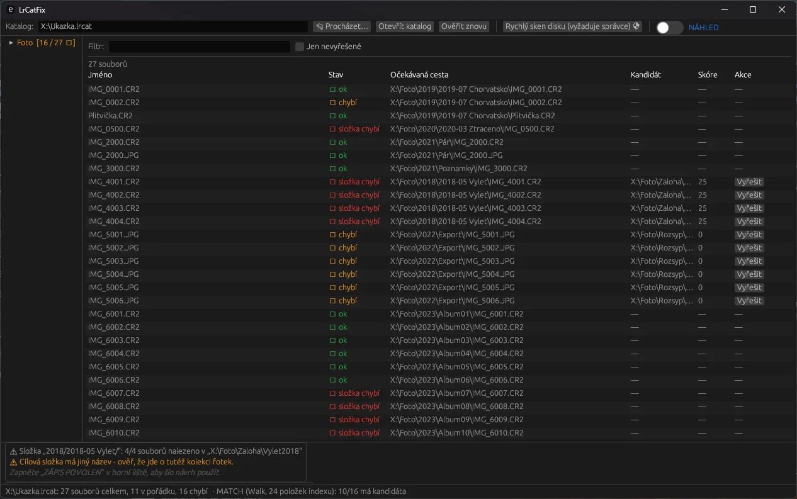

# LrCatFix

> 🇨🇿 [Česká verze](README.cs.md)

A Windows desktop tool that finds photos with broken paths in a **Lightroom Classic** catalog (`.lrcat`), locates the files on disk, and — **only after you approve each change** — repairs the paths in the catalog.

Built in Rust with an `egui` GUI. Also usable headless from the CLI.



*Screenshot from a fictional test catalog (same scenarios as `tests/fixtures/make.rs`).*

---

## What problem it solves

Lightroom Classic stores absolute file paths in its catalog. Move photos outside of Lightroom — reorganize folders, swap an external drive letter, restore from a backup — and LrC shows `!` on every affected photo. The built-in *Find Missing Photos* repairs one folder at a time, manually.

LrCatFix automates the search and, crucially, recognizes **patterns** instead of treating 30 000 broken photos as 30 000 unrelated problems:

| Pattern | Detection | Offered fix |
|---|---|---|
| **Drive letter changed** (`E:` → `F:`) | Volume probe at startup, < 1 s, no disk scan | One `UPDATE` on the root folder |
| **Folder moved** | ≥ 80 % of a folder's files found together elsewhere | One `UPDATE` on the folder — or move the files back |
| **Folder scattered** | Files spread across ≥ 5 different folders | Consolidate back into the source folder |
| **Album scattered** | Collection spanning ≥ 10 folders, ≥ 30 % missing | Detection only — see [Limitations](#limitations) |

Renamed folders are detected just as reliably as moved ones: detection is driven by **where the files were actually found**, not by folder-name similarity.

---

## Safety model

The catalog holds years of irreplaceable editing work. The governing rule of this codebase is:

> **A corrupted catalog is worse than a broken tool.**

Concretely, and enforced in code:

- **Preview mode by default.** Writing requires an explicit toggle plus a confirmation dialog that states exactly what will happen (how many DB rows, how many file moves, how many GB).
- **No write without a verified backup.** The backup must pass `PRAGMA integrity_check` and a size check before a write connection is even opened.
- **Refuses to write while Lightroom is open.** `.lrcat.lock` / `-journal` / `-wal` are re-checked immediately before writing, not just at startup.
- **Never touches** `journal_mode`, `page_size`, `encoding`, `user_version`. No `VACUUM`, no `writable_schema`.
- **Never deletes a file.** The single exception is deleting the source after a byte-verified cross-volume copy — that is the definition of a move, not cleanup.
- **Two-phase commit with compensation.** Filesystem moves happen first; SQL is generated only from moves that provably succeeded. If the DB transaction fails, committed moves are rolled back.
- **Everything is journaled before it happens** (`journal.jsonl`, `fsync`'d), so undo can replay backwards.
- **Schema guard.** Tables and columns are verified before any query. No `SELECT *`, ever.
- **Unavailable ≠ missing.** A disconnected NAS is reported distinctly from a genuinely deleted folder, and files on it are *never* offered for repair. Without this distinction, an unplugged drive would look like lost photos and the tool would offer to repoint your catalog at a backup copy.
- **No panics in production code.** No `.unwrap()`/`.expect()` outside tests; the GUI layer may never panic.

---

## Installation

Requires a Rust toolchain. On Windows, either MSVC or GNU (MinGW-w64) targets work.

```bash
git clone <repo>
cd lrrepair
cargo build --release
```

The result is a single self-contained `lrcatfix.exe` — no runtime, no installer.

---

## Usage

### GUI

```bash
lrcatfix                                  # start empty, open a catalog from the UI
lrcatfix --catalog "D:\Foto\Katalog.lrcat"
```

Layout follows a Total Commander idiom: folder tree on the left, file table on the right (virtualized — 30 000 rows scroll smoothly), suggestion cards at the bottom, mode indicator in the status bar. **PREVIEW** is blue, **WRITE ENABLED** is red — you should never be in doubt about whether you are modifying data.

### CLI (read-only report)

```bash
lrcatfix --catalog <path.lrcat> --headless
lrcatfix --catalog <path.lrcat> --headless --report out.json
```

Prints:

* counts (OK / missing / folder missing / on unavailable volume);
* MATCH statistics plus a **best-score distribution** and a diagnostic explaining why confident matches did or did not appear (e.g. whether file size from `importHash` is available when `md5` is empty);
* **all four CLUSTER patterns** — root remap (D), folder moved (A), scattered folder (B), scattered album (C). The CLI and the GUI call the same `cluster::detect_all`, so they cannot drift apart.

`--report` additionally writes full per-file candidates as JSON.

### CLI (write)

```bash
# Prints a summary and exits WITHOUT writing:
lrcatfix --catalog <path.lrcat> --headless --apply-root-remap 3

# Actually writes (backup is created automatically first):
lrcatfix --catalog <path.lrcat> --headless --apply-root-remap 3 --confirm
```

### Other flags

| Flag | Meaning |
|---|---|
| `--resume <session.json>` | Used internally when the GUI restarts elevated for the fast MFT scan |

---

## How it works — the pipeline

```
[0] OPEN      lock detection, schema guard
[1] EXTRACT   SQL join → expected absolute path for every AgLibraryFile row
[2] VERIFY    batched existence check (one read_dir per folder, parallel)
[3] INDEX     Everything IPC → MFT scan → parallel walk (first one that works)
[4] MATCH     candidates by filename + scoring
[5] CLUSTER   pattern detection, evaluated D → A → B → C
[6] REVIEW    you approve or reject each proposal
[7] APPLY     backup → journal → two-phase commit
[8] UNDO      replay the journal backwards
```

Phases 1–5 are strictly read-only and repeatable.

### Scoring (phase MATCH)

Candidates share the filename; the score decides which one is right:

| Signal | Points |
|---|---|
| Siblings — other files from the same source folder found in the same target | +25 |
| `externalModTime` matches (± 2 s) | +25 |
| Relative subpath matches exactly | +15 |
| Target folder name is similar (normalized Levenshtein ≥ 0.7) | +8 |
| Candidate sits in a folder the catalog already knows | +5 |
| **File size matches the catalog** | **+30** |
| MD5 matches the catalog's `md5` column | +100 (certainty) |
| Candidate is a cloud placeholder | −5 |
| Candidate is in the recycle bin / `Temp` | −50 |
| Candidate is inside LrC backups or `*.lrdata` | −100 |

Auto-resolve requires score ≥ 70 **and** a ≥ 15 point margin over the runner-up — and even then only proposes; a human always approves.

**Where file size comes from.** The catalog has no dedicated size column, but `AgLibraryFile.importHash` encodes one. Verified on LrC 13.3 (5 000-row sample):

```
189345639 : S7301073.JPG : 3299111
captureTime  originalFilename  size in bytes
(Apple epoch)
```

Field 1 equals `originalFilename` in 5000/5000 rows, field 0 lands within a year of `captureTime` when read as an Apple epoch in 5000/5000, and field 2 equals the real on-disk size for 2953/2958 existing files (99.83 %). The 5 outliers were `.dng`, `.png` and `.tif` — formats LrC writes metadata back into — so **a size mismatch is never a penalty, only the absence of a bonus.** On catalogs whose schema lacks `importHash` the signal disables itself.

This matters because `md5` is empty in real catalogs (see *Limitations*), which would otherwise cap the reachable score at 63 — below the threshold.

The time signal is **calibrated empirically at runtime**: the tool compares ~200 existing files' real `mtime` against the catalog value to determine the epoch and unit. If correlation is below 95 %, the signal is switched off entirely rather than guessed.

---

## Repository layout

```
src/
  main.rs               CLI argument parsing, entry point, headless report
  lib.rs                library root (everything except the CLI/GUI shell)
  config.rs             defaults per PROJECT.md §14
  session.rs            minimal session for the elevated restart (--resume)

  catalog/              everything touching the .lrcat SQLite file
    open.rs             lock detection, read-only / read-write connections
    schema.rs           schema guard — verifies tables and columns exist
    extract.rs          the main EXTRACT query, collection membership
    apply.rs            two-phase commit, plan builders, VerifiedPath
    backup.rs           verified backup incl. free-space pre-check
    ids.rs              id_local / id_global generation for new rows

  fsops/                filesystem operations
    paths.rs            verbatim \\?\ conversion, NFC match keys
    verify.rs           batched existence check, FileStatus
    attrs.rs            cloud placeholder detection, size/mtime
    moves.rs            moves with retry, sidecar grouping
    hash.rs             MD5 (catalog compatibility)
    exif_thumbnail.rs   embedded JPEG thumbnail extraction
    shell.rs            "Reveal in Explorer", elevated relaunch
    volumes.rs          drive enumeration, free space, network detection

  index/                disk index ("Everything"-style layer)
    mod.rs              NameIndex, backend selection, exclusion patterns
    everything.rs       backend A — es.exe subprocess
    mft.rs              backend B — NTFS MFT scan (the only unsafe code)
    walk.rs             backend C — parallel walk (jwalk)
    cache.rs            on-disk index cache with TTL

  matching/
    score.rs            candidate scoring
    calibrate.rs        runtime time-epoch calibration

  cluster/              pattern detection
    root_remap.rs       pattern D — drive letter / root changed
    folder_moved.rs     pattern A — whole folder relocated
    scattered.rs        pattern B — folder scattered
    album_scattered.rs  pattern C — collection scattered (detection only)

  journal/
    write.rs            append-only JSONL journal, fsync before acting
    undo.rs             reverse replay

  app/                  egui GUI — UI only, no SQL and no direct I/O
    state.rs            AppState, background threads, apply orchestration
    panel_tree.rs       left panel — folder tree with badges
    panel_files.rs      right panel — virtualized file table
    panel_plans.rs      bottom panel — suggestion cards
    dialogs/duplicates.rs   duplicate picker (§6.2)

tests/
  fixtures/make.rs      realistic catalog + file tree generator
  m0_pipeline.rs        read-only pipeline
  full_pipeline.rs      full pipeline incl. real writes and undo
  compensation.rs       mandatory compensation-phase test
```

**Architectural boundary:** `app/` contains no SQL and no direct I/O — it only calls into `catalog/`, `fsops/`, `index/`, `cluster/`. This keeps the entire logic testable without launching a GUI.

---

## Key APIs

### Catalog

| Function | Purpose |
|---|---|
| `catalog::open::open_read_only(path)` | Opens with `SQLITE_OPEN_READ_ONLY`, runs the schema guard |
| `catalog::open::open_read_write(path)` | Same, but refuses if lock files are present |
| `catalog::open::detect_lock(path)` | Checks `.lock` / `-journal` / `-wal` |
| `catalog::extract::extract(conn)` | The main query → `Vec<CatalogFile>` with expected paths |
| `catalog::backup::create_backup(path)` | Verified backup (integrity check + size) |
| `catalog::apply::apply(...)` | The single entry point for every write |
| `catalog::apply::VerifiedPath::check(path)` | Pre-flight; the only way to prove a target exists |

`VerifiedPath` deserves a note: plan builders accept **only** this type, so the existence check cannot be forgotten — the compiler enforces it. It does not solve TOCTOU; it shrinks the window from "however long the user spent clicking through dialogs" to milliseconds.

### Filesystem

| Function | Purpose |
|---|---|
| `fsops::paths::to_verbatim(path)` | The **only** place that builds `\\?\` paths (works over WTF-16, so unpaired surrogates survive) |
| `fsops::paths::match_key(name)` | Normalized comparison key — lowercase then NFC. **Never** use for I/O |
| `fsops::verify::verify(files, threads)` | Batched existence check |
| `fsops::moves::move_file(src, dst)` | Move with retry; cross-volume = copy → verify → delete |
| `fsops::moves::find_sidecars(...)` | Finds `.xmp`/`.wav`/… belonging to a file |

### Index, matching, clustering

| Function | Purpose |
|---|---|
| `index::build_index(...)` | Tries backends A → B → C, handles the cache |
| `matching::run(...)` | INDEX + calibration + scoring in one step |
| `cluster::root_remap::probe_all(...)` | Volume probe (before any scan) |
| `cluster::folder_moved::detect(...)` | Pattern A |
| `cluster::scattered::detect(...)` | Pattern B |
| `cluster::album_scattered::detect(...)` | Pattern C |

---

## Configuration

Defaults (from `PROJECT.md` §14):

| Key | Default | Meaning |
|---|---|---|
| `scan.threads_local` | 16 | I/O threads for local volumes |
| `scan.threads_network` | 4 | I/O threads for network volumes |
| `match.auto_threshold` | 70 | Score needed for a confident match |
| `match.tie_margin` | 15 | Required lead over the runner-up |
| `match.folder_name_similarity` | true | Enables the folder-name bonus |

> **Note:** reading `config.toml` from disk is **not implemented yet** — the tool currently runs on these built-in defaults.

---

## Development

```bash
cargo build                  # debug
cargo build --release        # measure performance targets here only
cargo test                   # 249 tests
cargo clippy --all-targets -- -D warnings
cargo fmt --check
cargo test --test compensation   # mandatory compensation test
```

`cargo fmt --check`, `cargo clippy -- -D warnings` and `cargo test` must all pass before every commit.

Tests never run against a production catalog. `tests/fixtures/make.rs` generates a fresh synthetic catalog plus matching file tree for every test, covering: NFC/NFD diacritics, paths > 260 characters, RAW + `.xmp` + `.wav` groups, RAW + JPEG as two independent rows, a virtual copy, an empty folder, a moved folder, a scattered folder, and a scattered collection.

---

## Limitations

Deliberate scope decisions, not oversights:

- **Lightroom Classic only.** Lightroom CC (cloud) is not supported.
- **Paths only.** Develop settings, history, keywords, collections and ratings are never touched. Previews (`Previews.lrdata`) are never touched.
- **No fully automatic mode.** Auto-match proposes; a human approves.
- **Album merge (pattern C) is detection only.** The spec itself flags the physical merge as the most destructive operation in the tool; it needs a dedicated double-confirmation dialog that does not exist yet.
- **Name collisions during consolidation are rejected and reported**, never silently skipped or overwritten. The "rename to `_1`" and "pick manually" strategies are not implemented.
- **Creating a brand-new root folder is out of scope** — a repair target must fall under a root the catalog already knows.
- **Volume serial number identification** (`PROJECT.md` §7.4.2) is not implemented: it could not be verified whether LrC stores the identifier at all, and guessing is forbidden by the project rules. The volume probe achieves practically the same result.
- **`config.toml` is not read from disk yet.**

### Not verified

Stated plainly, because it matters before you point this at a real catalog:

- **No write has ever been performed against a genuine Lightroom-created catalog.** All tests run against synthetic fixtures. Reads, however, have been verified against a copy of a real LrC 13.3 catalog (26 807 files), which settled four previously-unverified questions:
  - `externalModTime` is `REAL` in the **Apple epoch** (2001-01-01); runtime calibration matched it at 100 %.
  - **`md5` is `NULL` for every row.** The certainty signal simply never fires on real catalogs — which is why the size signal above exists.
  - `Adobe_entityIDCounter` exists and holds the next free **global** `id_local`: across all 104 tables carrying `id_local`, the highest in use was 2811381 and the counter read 2811382.
  - `importHash` encodes capture time, original filename and file size (see *Scoring*).
- **What that verification does not cover:** how Lightroom behaves when it opens a catalog *after* this tool has written to it. That would require actually launching Lightroom. The backup, journal and undo path (§8, §9) is the safety net for that residual risk.
- **The "2M files under 15 s" MFT target is unmeasured** — no elevated access to a large NTFS volume was available.
- **The GUI has never been manually exercised.** It compiles, and its logic is unit-tested, but no one has clicked through it.

**Recommended before real use:** run it read-only (`--headless`) against a *copy* of your catalog first, and verify the copy still opens in Lightroom after any write.

---

## How it was built

Built with **Claude Code**, spec-first: `PROJECT.md` (full specification) and `CLAUDE.md` (working rules, invariants, definition of done) came before the code, then milestone by milestone with unit and integration tests (`tests/`).

---

## Documents

- **`PROJECT.md`** — the full specification: data model, algorithms, UI layout, milestones. Implementation deviations are recorded inline.
- **`CLAUDE.md`** — working rules for this repository: invariants, conventions, definition of done.

---

## License

[MIT](LICENSE) © 2026 Pavel Procházka
